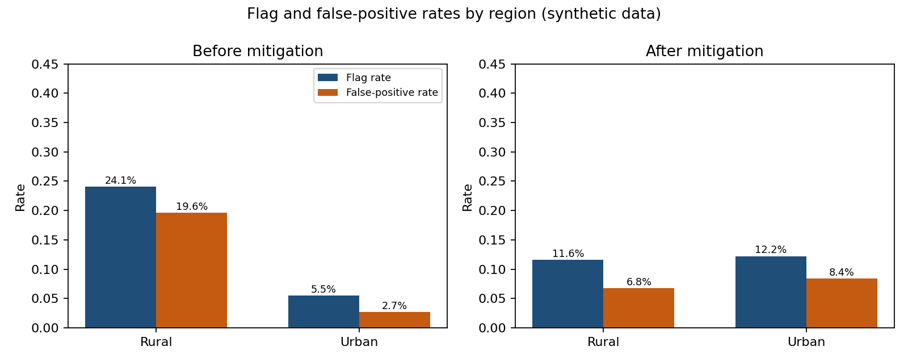
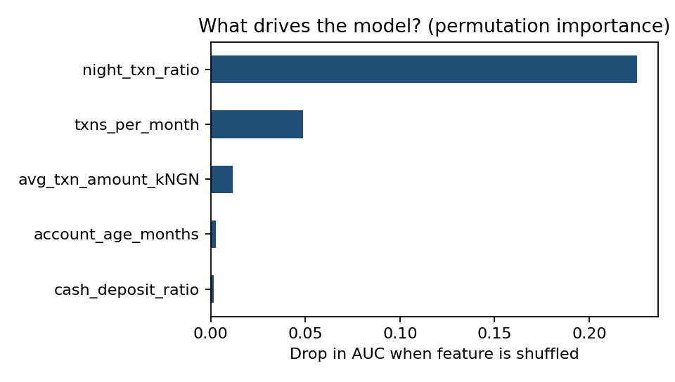
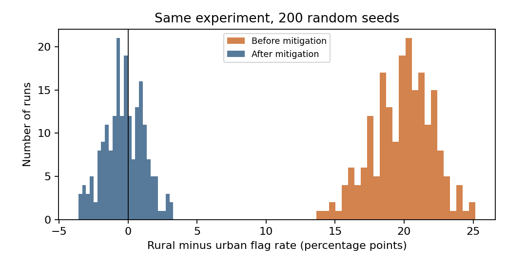

# SecureFinance Africa: AI Ethics, Governance and Legal Compliance Assessment

Coursework project for ICDFA AICS-201 (AI Ethics, Governance and Legal Frameworks), Assignment 01. It is a pre-deployment review of a **fictional** fintech platform that does identity verification, fraud detection and financial risk assessment. All data are synthetic. No real customer records are used.

**Read it:**
- [Final report (PDF)](https://github.com/Janetcyber/SecureFinance_AI_Governance/raw/main/docs/SecureFinance_AI_Governance_Assessment%20%281%29.pdf). If the preview does not load, click the three-dot menu, then Download.
- Risk register: [CSV](docs/risk_register.csv) or [Excel](docs/risk_register.xlsx)

## What the project covers
- Six ethical risks, each with cause, affected people, consequence and a proportionate control
- A 12-risk register (likelihood, impact, owner, controls, residual rating) built on the NIST AI Risk Management Framework
- Binding law versus non-binding principles: Nigeria Data Protection Act 2023, EU AI Act, UNESCO, OECD
- A reproducible Python fairness test on synthetic data, with explainability, a mitigation and a 200-seed stability check
- A deployment recommendation: conditional approval for a limited pilot with human review

## Headline result (synthetic data)
The model never sees a customer's region, yet it treats regions unequally.

| | Rural flag rate | Urban flag rate | Rural false-positive rate | Urban false-positive rate |
|---|---|---|---|---|
| Before mitigation | 24.1% | 5.5% | 19.6% | 2.7% |
| After peer-group normalisation | 11.6% | 12.2% | 6.8% | 8.4% |





## Repository contents
| Path | What it is |
|---|---|
| `docs/` | Final report (PDF) and risk register (CSV and Excel) |
| `data/` | Synthetic dataset (4,000 fictional customers) |
| `src/` | Python scripts: data generation, fairness analysis, stability check, report builder |
| `outputs/` | Metric tables, charts and reason codes produced by the analysis |
| `Evidence/` | Screenshots of the analysis being run in Google Colab |

## Reproduce
```
pip install -r requirements.txt
python src/fairness_analysis.py
python src/stability_check.py
python src/build_outputs.py
```
The random seed is fixed (42), so results repeat exactly.

## Limitations
The data are synthetic and the bias was built in by design, so the size of the effect says nothing about any real system. The test set holds about 83 fraud cases, so some rates are noisy. Only two groups were tested, and the four-fifths rule is a heuristic, not a Nigerian legal standard.

## Note on the final report
The final PDF was edited manually in Google Docs; all figures come from the scripts in `src/`.
